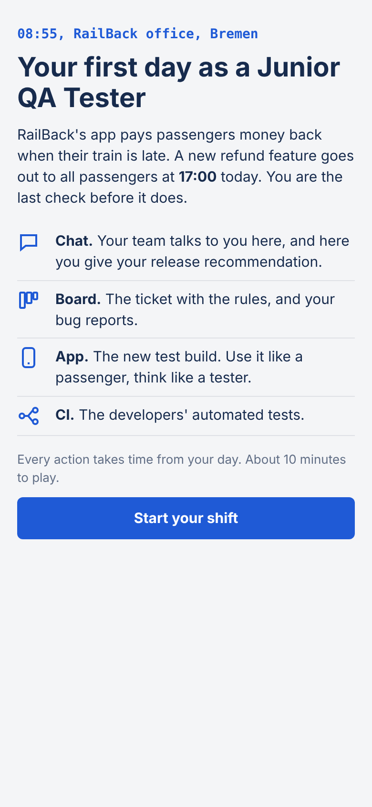
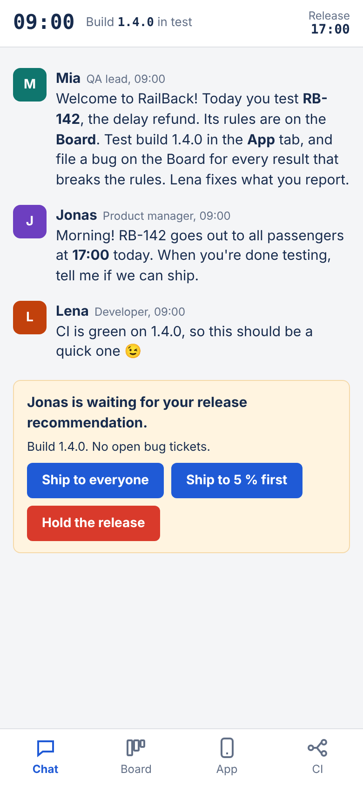
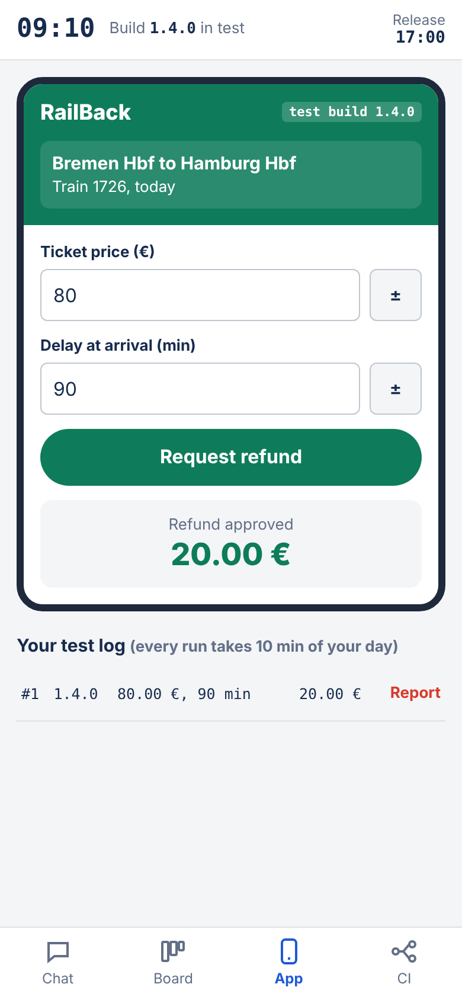
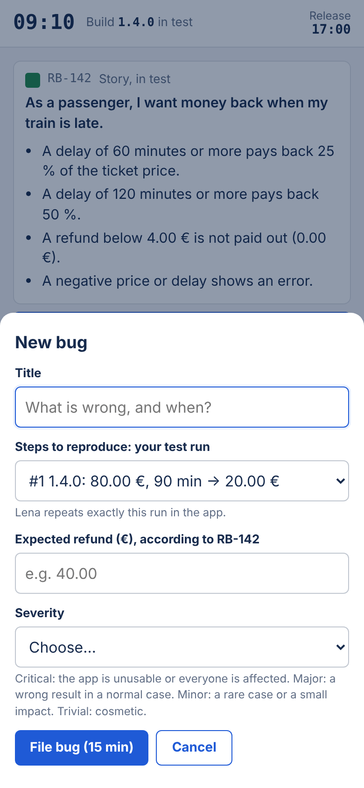
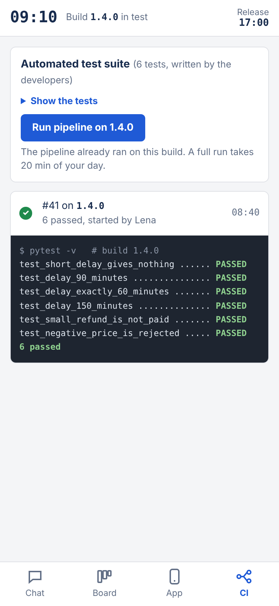
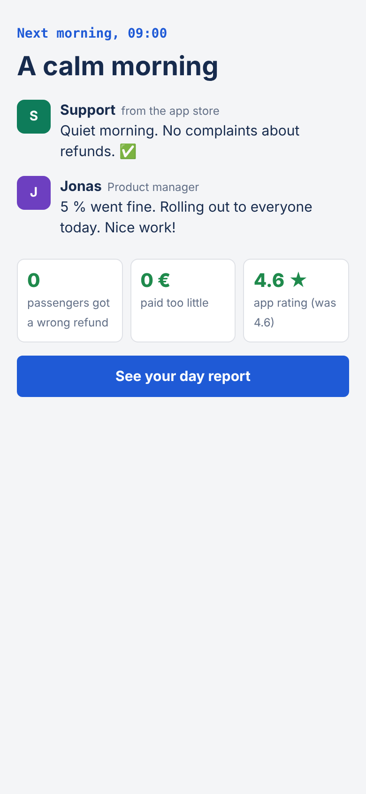

# QA First Day

A 10-minute simulation for the Software Testing tutorial (Software Development and Operations,
Constructor University): **your first day as a Junior QA Tester** at RailBack, a made-up startup
whose app pays passengers money back when their train is late.

Play it here: https://uhuseynov.github.io/sdo-qa-simulation/

## Screenshots

<table>
  <tr>
    <td align="center" width="33%"> Start of the day</td>
    <td align="center" width="33%"> Chat: the team and the release decision</td>
    <td align="center" width="33%"> App: the build under test</td>
  </tr>
  <tr>
    <td align="center" width="33%"> Board: filing a bug report</td>
    <td align="center" width="33%"> CI: the developers' tests</td>
    <td align="center" width="33%"> The next morning</td>
  </tr>
</table>

## How it works

The release goes out at 17:00. Until then you work in a small QA workspace:

| Tab | What you do there |
|-----|-------------------|
| Chat | The team talks to you: Mia (QA lead), Lena (developer), Jonas (product manager). You give your release recommendation here. |
| Board | The ticket with the rules (RB-142) and your bug reports. |
| App | The build under test. Every run takes 10 minutes of your day. |
| CI | The developers' automated tests. A full run takes 20 minutes. |

There are no quiz questions. Bugs you report get fixed in a new build (and a fix can break something
else). Bugs you miss reach the passengers: the next morning shows the complaints, the money and the
app rating. The day report scores what you did (max. 100 points).

## Files

| File | What it is |
|------|------------|
| `index.html` | The whole simulation: one file, no build step. GitHub Pages serves it as it is. |
| `supabase.sql` | Creates the leaderboard table in Supabase. |
| `qr-sdo-qa-simulation.png` | QR code to the page, used on the last tutorial slide. |
| `screenshots/` | The screenshots in this README. |

## Leaderboard (optional)

1. In your Supabase project open **SQL Editor**, paste `supabase.sql` and run it.
2. Copy the project URL (`https://xxxx.supabase.co`, shown in the **Connect** dialog) and, from
   **Settings → API Keys**, the **publishable** key (`sb_publishable_...`, the legacy `anon` key works too).
   Never use a secret / service_role key in a web page.
3. Put both at the top of the script in `index.html`:
   `const LEADERBOARD = { url: "https://xxxx.supabase.co", anonKey: "...", table: "qa_sim_scores" };`

Without these two values the leaderboard is simply hidden. Rude nicknames can be deleted in the
Supabase **Table Editor**.

The practice files for the tutorial are in [sdo-testing-lab](https://github.com/uhuseynov/sdo-testing-lab).
